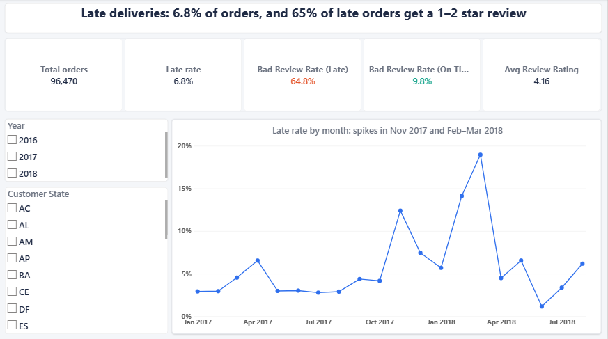
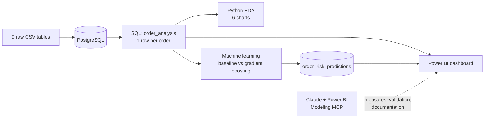
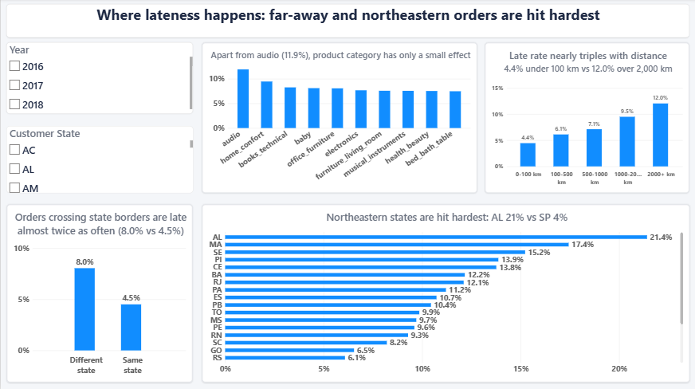
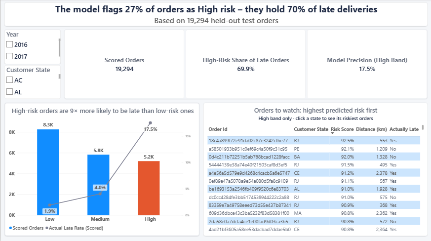

# Late Delivery Prediction & Customer Satisfaction Analysis

> **Can we tell, at the moment a customer clicks "Buy", whether their order will arrive late, and does it matter?**
>
> An end-to-end analytics project on ~100,000 real e-commerce orders: **PostgreSQL → SQL data modeling → Python EDA → machine learning → Power BI**, with an AI assistant (Claude) connected directly to the Power BI model to generate, validate and document DAX measures.




---

## TL;DR

| | Finding |
|---|---|
| **The problem** | **6.8%** of delivered orders (6,534 of 96,470) arrive after the promised date. |
| **Why it matters** | Late orders are **6.6× more likely** to get a 1–2 star review: **64.8%** vs **9.8%** for on-time orders. |
| **Where & when** | Lateness rises from **4.4%** (under 100 km) to **12.0%** (over 2,000 km), hits **21%** in Alagoas vs **4.5%** in São Paulo, and peaked at **19%** in March 2018. |
| **The model** | A gradient boosting model (**ROC-AUC 0.79**) flags **27%** of orders as *High risk*, and that group contains **70% of all late deliveries**. |
| **The dashboard** | A 3-page Power BI report (overview, delay drivers, order risk), with measures validated against the SQL and Python results. |

---

## 1. Business problem

[Olist](https://www.kaggle.com/datasets/olistbr/brazilian-ecommerce) is a Brazilian marketplace that connects small sellers with customers across the country. At checkout, every customer sees an **estimated delivery date**. When an order arrives after that date, customers leave bad reviews, which hurts trust, repeat purchases and sales.

This project answers three questions:

1. **How big is the problem?** How many orders are late, and how much worse are their reviews?
2. **Where and why does it happen?** Which regions, distances, product categories and periods drive lateness?
3. **Can we predict it?** Using only information available **at checkout**, can we flag the orders most likely to be late, so Olist can act *before* the customer is disappointed?

---

## 2. Data

- **Source:** [Brazilian E-Commerce Public Dataset by Olist](https://www.kaggle.com/datasets/olistbr/brazilian-ecommerce) (Kaggle), orders from 2016–2018
- **9 relational tables:** orders, customers, order items, payments, reviews, products, sellers, geolocation (~1M rows) and category translations
- **Analysis scope:** **96,470 delivered orders**

The raw CSVs are not stored in this repository; see [`data/README.md`](data/README.md) for the download link.

---

## 3. Approach



### 3.1 Data modeling in SQL
[`sql/01_setup.sql`](sql/01_setup.sql) creates the schema (keys, foreign keys, indexes) and loads the data. [`sql/02_analysis_table.sql`](sql/02_analysis_table.sql) joins all 9 tables into one analysis table, **`order_analysis`**, with **one row per order**.

Key techniques:
- **Aggregate before joining:** "many rows per order" tables (items, payments, reviews) are summarized in CTEs first, so joins never duplicate orders.
- **Window function:** `ROW_NUMBER()` picks each order's most expensive item, which defines the order's main seller and product category.
- **`ARRAY_AGG(... ORDER BY ...)[1]`** picks the payment type of the largest payment.
- **Data cleaning:** geolocation points outside Brazil's coordinates are removed before averaging coordinates per zip code.
- **Feature engineering:** seller-to-customer distance with the **haversine formula**, promised vs actual delivery days, a same-state flag, and the target `is_late`.

[`sql/03_business_questions.sql`](sql/03_business_questions.sql) answers 5 business questions on that table: the review impact, and the late rate by state, product category, month and seller.

### 3.2 Exploratory data analysis
[`notebooks/01_eda.ipynb`](notebooks/01_eda.ipynb) loads the table straight from PostgreSQL and turns the questions into charts.

| # | Question | Finding |
|---|---|---|
| 1 | Does lateness hurt satisfaction? | **64.8%** of reviewed late orders got 1–2 stars, vs **9.8%** of on-time orders. |
| 2 | Where is it worst? | Northeastern states: **AL 21.4%**, **MA 17.4%**, **SE 15.2%**, vs **SP 4.5%**. Rio de Janeiro (**12.1%**) is high despite being close to São Paulo. |
| 3 | Is there seasonality? | Spikes in **Nov 2017 (12.4%, Black Friday)** and **Feb–Mar 2018 (14.1% → 19.0%)**, then back to **4.5%** in April. |
| 4 | Does distance matter? | Yes: **4.4% → 6.1% → 7.1% → 9.5% → 12.0%** from under 100 km to over 2,000 km. Orders crossing state borders are late **8.0%** of the time vs **4.5%** within a state. |
| 5 | Do product categories matter? | Only slightly. Apart from **audio (11.9%)**, the top categories sit at 7.5–9.5%, close to the 6.8% average. |
| 6 | How accurate are the promises? | Very cautious: Olist promises **~24 days**, delivery takes **~12.5 days**, and most orders arrive about **12 days early**, yet a tail of orders still arrives 10–30+ days late. |

### 3.3 Machine learning
[`notebooks/02_model.ipynb`](notebooks/02_model.ipynb) predicts `is_late` for each order.

**Preventing data leakage.** The model may only use information that exists **when the customer clicks "Buy"**. Actual delivery time and review score are known only after delivery, so they are excluded. IDs and zip codes are excluded as well, since they are labels rather than information.

**Features (15 → 137 after one-hot encoding):** customer and seller state, product category, payment type, promised delivery days, distance, same-state flag, number of items and sellers, weight, price, freight, installments, purchase month and weekday.

**Setup:**
- 80/20 train/test split, **stratified** so both sets keep the 6.8% late rate
- missing values filled with **medians from the training set only**, so no information leaks from the test set
- `class_weight="balanced"` to handle the class imbalance

**Results on 19,294 unseen test orders:**

| Model | ROC-AUC | Recall (late) | Precision (late) | Late orders caught | False alarms |
|---|---|---|---|---|---|
| "Lazy" baseline (always *on time*) | 0.50 | 0% | – | 0 | 0 |
| Logistic regression | 0.715 | 65% | 12.5% | 855 | 5,994 |
| **Gradient boosting** | **0.794** | **70%** | **17.5%** | **913** | **4,291** |

> The lazy baseline scores **93% accuracy** while catching zero late orders, which is why accuracy is not used to judge the models here.

Gradient boosting improves on the baseline on every measure: it catches **58 more late orders** while raising **28% fewer false alarms**, because it learns *combinations* of risk factors (e.g. far away **and** a short promise **and** a peak month).

**What drives the predictions** (permutation importance, drop in ROC-AUC when a feature is shuffled):

| Driver | Importance |
|---|---|
| Purchase month | 0.143 |
| Promised delivery days | 0.082 |
| Distance | 0.049 |
| Customer / seller location (all state columns combined) | ~0.053 |
| Order size, price, weight, freight | each < 0.01 |

**Risk bands.** Every test order gets a risk score, grouped into bands:

| Risk band | Orders | Actually late |
|---|---|---|
| Low (< 0.3) | 8,261 | **1.9%** |
| Medium (0.3–0.5) | 5,829 | **4.0%** |
| High (> 0.5) | 5,204 | **17.5%** |

High-risk orders are **9× more likely** to be late than low-risk ones. The High band holds **27% of orders but 70% of late deliveries**.

The scores are written back to PostgreSQL (`order_risk_predictions`) for the dashboard.

### 3.4 Power BI dashboard
[`dashboard/olist_delivery_dashboard.pbix`](dashboard/olist_delivery_dashboard.pbix) connects to PostgreSQL and links both tables 1:1 on `order_id`.

**Page 1: Overview.** *How big is the problem?* KPI cards and the monthly late-rate trend.


**Page 2: Delay drivers.** *Where and why does lateness happen?* Late rate by state, distance band, product category and route type.


**Page 3: Order risk.** *Which orders should Olist watch?* Model performance, risk bands and a ranked list of high-risk orders that filters by state.


**Model highlights:** 19 DAX measures organized in display folders (Delivery, Reviews, Trends, Model performance, Order table), calculated columns for distance bands, route type and sort orders, and synced slicers across pages.

### 3.5 AI-assisted BI: Claude + Power BI Modeling MCP
I connected **Claude** (Anthropic) to the open Power BI file through Microsoft's **[Power BI Modeling MCP server](https://github.com/microsoft/powerbi-modeling-mcp)**, so the assistant could read and edit the semantic model directly.

| I built | The AI assisted with (reviewed by me) |
|---|---|
| Data connection, relationship, core measures (`CALCULATE`, `DIVIDE`), all report pages and visuals | **Advanced measures:** previous-month late rate, month-over-month change (`DATEADD`), the High band's share of late orders, model precision |
| | **Validation:** DAX queries comparing every key dashboard number with the SQL and Python results |
| | **Documentation:** descriptions for 2 tables, 31 columns and 19 measures |
| | **Best-practice review:** summarization settings, number formats, hidden helper columns, display folders |

**A bug the validation caught:** DAX treats a *blank* distance like 0 in comparisons, so 477 orders without coordinates silently landed in the "0–100 km" band (4.6% instead of 4.4%). The fix was to exclude blanks explicitly, and those orders now appear as "Unknown".

---

## 4. Recommendations

1. **Use the risk score at checkout.** Flag High-risk orders (27% of orders, 70% of late deliveries) for proactive messages, prioritized handling or extra buffer days.
2. **Make delivery promises distance- and region-aware.** Promises are about twice as long as actual delivery on average: offer shorter, more attractive estimates for nearby orders, and realistic ones for long-distance and northeastern routes.
3. **Plan for peak periods.** Add logistics capacity and adjust promised dates around Black Friday and early-year peaks.
4. **Investigate Rio de Janeiro.** Its 12.1% late rate isn't explained by distance, which points to local logistics issues.
5. **Monitor sellers with consistently high late rates** (`sql/03_business_questions.sql`, query 5) and set stricter shipping deadlines.

---

## 5. Limitations & next steps

- **Period-specific seasonality.** The data covers about two years, so part of the strong month effect may reflect disruptions specific to late 2017 and early 2018. A **time-based split** (train on older orders, test on the newest months) would show how well the model handles unseen periods.
- **Straight-line distance.** Distance is measured between zip-code centers, not along roads.
- **Threshold tuning.** The "late" cut-off is 0.5. Moving it trades recall against precision and could be tuned to the cost of a missed late order vs a false alarm.
- **Date table.** The Power BI model uses automatic date hierarchies; a dedicated date table would be the next modeling improvement.

---

## 6. Repository structure

```
├── sql/
│   ├── 01_setup.sql              # schema, keys, indexes, data load
│   ├── 02_analysis_table.sql     # builds order_analysis (1 row per order)
│   └── 03_business_questions.sql # 5 business queries
├── notebooks/
│   ├── 01_eda.ipynb              # data quality checks + 6 EDA charts
│   └── 02_model.ipynb            # features, baseline, gradient boosting, risk scores
├── dashboard/
│   ├── olist_delivery_dashboard.pbix
│   └── screenshots/
├── data/README.md                # dataset download link
└── requirements.txt
```

## 7. How to reproduce

1. Download the dataset from Kaggle (link in [`data/README.md`](data/README.md)).
2. Create a PostgreSQL database `olist`, adjust the file paths in `sql/01_setup.sql`, and run it with `psql`.
3. Run `sql/02_analysis_table.sql` to build `order_analysis`, then explore `sql/03_business_questions.sql`.
4. Install the Python dependencies: `pip install -r requirements.txt`.
5. Run `notebooks/01_eda.ipynb`, then `notebooks/02_model.ipynb` (this writes `order_risk_predictions` to PostgreSQL). Update the connection string to your own credentials.
6. Open `dashboard/olist_delivery_dashboard.pbix` in Power BI Desktop and refresh the data source.

## 8. Tech stack

**PostgreSQL** (CTEs, window functions, `ARRAY_AGG`) · **Python** (pandas, SQLAlchemy, matplotlib, seaborn) · **scikit-learn** (logistic regression, `HistGradientBoostingClassifier`, permutation importance) · **Power BI** (DAX, data modeling) · **Claude + Power BI Modeling MCP** · **Git/GitHub**
